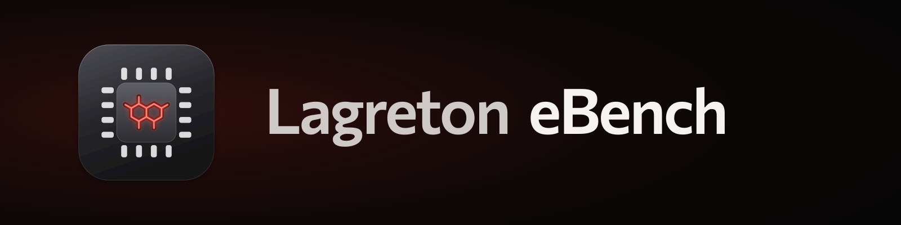
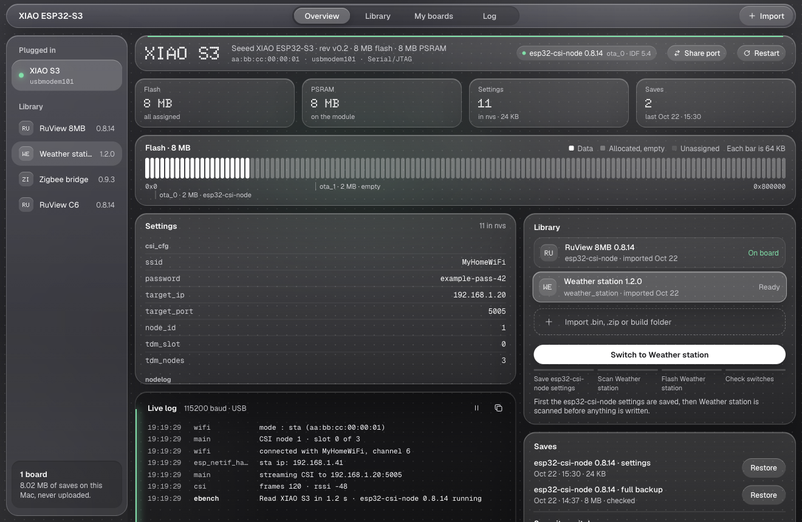

<p align="center">

</p>
<p align="center">
<a href="LICENSE"></a>


</p>

# Lagreton eBench

Lagreton eBench is a Mac app for your ESP32 boards. Plug a board in to see what it runs, back it up, and switch it between firmware you've imported, without losing each firmware's settings. Boards, backups and firmware stay on your Mac.



## Features

- **Reads any board** you plug in: chip, flash map, running firmware, settings and security switches.
- **Backups**: full flash backups checked against the board, and per-firmware settings saves.
- **Library**: import a `.bin`, a `.zip` or `.tar.gz` release, or an ESP-IDF build folder once, then use it on any board it fits.
- **Switching**: the outgoing firmware's settings are saved, the incoming bootloader is scanned for encryption or secure boot, and the incoming firmware's own settings go back on.
- **My boards**: every board you've used, with its saves and history, plugged in or not.
- **Lock open** (ESP32-S3 and C6): permanently write-protects the eFuses that could turn on encryption, secure boot or disable USB flashing. It runs on a virtual copy of the chip first.

## Get started

You need macOS on Apple silicon and [uv](https://docs.astral.sh/uv/).

```sh
git clone https://github.com/LagretonSoftware/lagreton-ebench
cd lagreton-ebench
uv run ebench
```

To build the app: `uv run pyinstaller --noconfirm ebench.spec`, which makes `dist/eBench.app`.

Backups hold your Wi-Fi passwords. They live in `~/Library/Application Support/Lagreton eBench` and are never uploaded.

## License

[AGPL-3.0](LICENSE). The Lagreton name and logo are not covered by the license.
